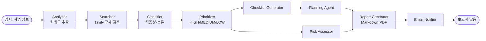

# RegTech Assistant — 규제 준수 분석 멀티 에이전트

사업 정보를 입력하면 적용 규제를 검색·분류하고, 체크리스트·리스크 평가·PDF 보고서 생성과 이메일 발송까지 자동으로 수행하는 **LangGraph 기반 9-에이전트 파이프라인**입니다.

- **기간**: 2025.10.16~23 (SK AX SKALA 2기 미니 프로젝트, 개발 3일) · 3인 팀. 프로젝트가 끝난 뒤 병렬 분기 결함을 고치고 다시 측정했습니다
- **팀 방식**: 세 명이 함께 코드를 작성했고, 팀 저장소에는 팀원 한 명이 모아서 올렸습니다. 이 저장소는 그 최종본을 공개용으로 정리한 것입니다.
- **본인(김재민) 담당**: 검색(Searcher), 분류(Classifier), 리스크 평가(Risk Assessor) 단계 구현. 서비스 기획 초안(대상 고객, 입력과 출력 정의), 법령 API·판례 출처 조사, 발표 구성. 법령 PDF 벡터 검색(Chroma)은 따로 실험했고 최종본에는 넣지 않았습니다.
- **스택**: Python 3.11 · LangGraph 1.0 · LangChain · GPT-4o-mini · Tavily Search API · TypedDict · WeasyPrint

## 문제 / 배경

대기업은 법무팀이 규제를 관리하지만, 중소 제조기업은 전담 조직이 없어 적용 규제를 직접 파악하기 어렵습니다. 규제라는 도메인은 **근거 없는 출력(환각)이 곧 서비스 실격**이라, LLM 호출 한 번으로 처리하는 대신 검증 가능한 단계로 파이프라인을 쪼개는 설계를 선택했습니다.

## 아키텍처



| 에이전트 | 역할 |
|---|---|
| Analyzer | 사업 정보에서 규제 검색 키워드 도출 |
| Searcher | Tavily로 정부·공식 사이트 위주 검색, **출처 ID 부여** |
| Classifier | 적용성 판단, 카테고리 분류(안전/환경·제품인증·공장운영) |
| Prioritizer | 법정 필수 HIGH / 유예 가능 MEDIUM / 권장 LOW |
| Checklist Generator · Risk Assessor | **병렬 실행** — 실행 항목 생성 / 벌칙·영향·완화방안 평가 |
| Planning Agent | 체크리스트를 일정·의존성·마일스톤 계획으로 변환 |
| Report Generator | 전 결과 통합 Markdown·PDF 보고서 |
| Email Notifier | Gmail SMTP 발송 |

Prioritizer 이후 두 브랜치가 병렬로 실행되고, 둘 다 끝난 뒤 Report Generator가 한 번 실행됩니다. 상태 관리·분기·합류를 그래프 선언으로 처리할 수 있다는 것이 단순 함수 체인 대신 LangGraph(StateGraph)를 쓴 이유입니다.

## 내가 구현한 단계

| 단계 | 파일 | 하는 일 |
|---|---|---|
| Searcher | `regtech_agent/agents/searcher.py` | 키워드로 Tavily를 검색해 최대 10건을 받고, 결과마다 `SRC-001` 형식의 출처 ID를 붙입니다. 본문은 300자로 잘라 다음 단계로 넘깁니다. |
| Classifier | `regtech_agent/agents/classifier.py` | 검색 요약을 출처 ID와 함께 프롬프트에 넣고, 규제마다 출처 ID를 1개 이상 달아 JSON으로 답하게 합니다. 응답의 출처 ID를 검색 결과와 맞춰 제목과 URL을 채웁니다. |
| Risk Assessor | `regtech_agent/agents/risk_assessor.py` | 규제별로 벌칙 유형, 벌칙 수준, 0~10점 리스크 점수를 받습니다. 응답을 읽지 못하거나 점수가 숫자가 아니면 5.0으로 둡니다. 7점 이상을 고위험으로 묶고 전체 평균을 냅니다. |

세 단계 모두 LangChain의 `@tool`로 정의했고, `nodes.py`의 그래프 노드가 정해진 순서로 실행합니다. 모델이 도구를 고르는 방식은 쓰지 않았습니다. 규제 분석은 단계 순서가 정해져 있어 경로를 그래프로 고정하는 편이 결과를 추적하기 쉽다고 봤습니다.

## 설계 포인트

1. **출처를 보고서까지 전달하려는 설계**: Searcher가 검색 결과에 출처 ID를 붙이고, Classifier 프롬프트가 그 ID로만 근거를 달도록 지시합니다. 응답의 ID는 검색 결과와 맞춰 보지만, 맞지 않는 ID를 걸러 내지는 않습니다(아래 "알려진 문제").
2. **출력 구조**: 각 에이전트의 출력을 TypedDict(`regtech_agent/models.py`)로 정의하고 LLM 응답을 `json.loads`로 파싱합니다. 형식이 무너지면 다음 에이전트가 연쇄적으로 무너지기 때문에 구조를 먼저 정했습니다.
3. **단일 책임 분리**: 어느 단계에서 왜 틀렸는지 추적할 수 있도록 검색·분류·우선순위·생성을 분리했습니다. 3일 MVP였기 때문에 확장성·보안·대규모 사용자는 PRD에서 명시적으로 범위 밖으로 뺐습니다(`agent_prd_v2.md`).

## 구조

```
regtech_agent/
├── agents/            # 9개 에이전트 구현
├── workflow.py        # StateGraph 구성 — 순차/병렬 엣지 정의
├── nodes.py           # 에이전트를 그래프 노드로 연결
├── models.py          # AgentState·TypedDict 출력 모델
├── email_utils.py     # Gmail SMTP 발송
└── utils.py           # Tavily 클라이언트 등
run_regtech_agent.py   # 실행 진입점 (샘플 사업 정보 포함)
report/                # 예시 산출물 (PDF·Markdown)
tests/                 # 그래프 구조 테스트 (모델·검색 호출 없음)
scripts/measure.py     # 실행 측정 (노드 실행 횟수, 모델 호출 수, 출처 연결)
```

## 실행 방법

```bash
pip install -r requirements.txt        # Python 3.11 기준
cp .env.example .env                   # OpenAI, Tavily 키 입력 (Gmail은 메일을 보낼 때만)
python run_regtech_agent.py            # 또는: python run_regtech_agent.py 수신자@example.com
python -m pytest tests -q              # 그래프 구조 테스트 (키 없이 실행)
```

PDF 생성에 쓰는 WeasyPrint는 pango가 설치돼 있어야 합니다(macOS: `brew install pango`).

실행하면 규제 분석 → `report/`에 PDF·Markdown 보고서 생성 → (수신자 지정 시) 이메일 발송까지 진행되고, 전체 결과가 `regulation_analysis_result.json`으로 저장됩니다. 예시 산출물: [`report/regulation_report_v2.pdf`](report/regulation_report_v2.pdf)

## 결과

- 실사용자 없이 입력부터 보고서 발송까지 동작하는 프로토타입입니다.
- 성공 기준으로 잡은 규제 10개 중 실제 실행에서는 3~5개가 나왔습니다.

### 후속 측정

`scripts/measure.py`로 샘플 입력(배터리 제조)을 실제 모델(gpt-4o-mini)과 검색(Tavily)으로 실행했습니다. MacBook Pro M5, 병렬 분기 수정 전과 후를 각각 6회.

| 항목 | 수정 전 (6회) | 수정 후 (6회) |
|---|---|---|
| Report Generator 실행 | 매번 2회 | 매번 1회 |
| 첫 보고서 생성 때 실행계획 수 | 0건 | 4~5건 |
| Email Notifier 실행 | 2회 | 1회 |
| 전체 모델 호출 (평균) | 17.5회 | 17.0회 |
| 전체 시간 (평균) | 79.8초 | 84.8초 |

- 12회 실행에서 찾은 규제 51건 모두 검색 결과의 출처 ID와 연결됐습니다. 검색 목록에 없는 출처 ID는 0건이었습니다.
- 전체 시간은 수정으로 줄지 않았습니다. 실행마다 찾은 규제 수에 따라 62~93초로 달라지고, 그 폭이 수정 효과보다 큽니다. 이 수정은 속도가 아니라 정확성을 고친 것입니다.

## 고친 문제: 병렬 분기 뒤 보고서가 두 번 만들어짐

- **증상**: Report Generator와 Email Notifier가 실행마다 두 번 돌았습니다. 첫 번째 보고서는 실행계획이 빈 상태로 만들어졌습니다.
- **원인**: 길이가 다른 두 갈래(Checklist → Planning, Risk)를 Report Generator에 엣지 두 개로 따로 연결했습니다. 짧은 갈래가 끝나면 보고서가 한 번 실행되고, 긴 갈래가 끝나면 한 번 더 실행됩니다.
- **재현**: 9개 노드를 실행 횟수만 세는 대역으로 바꾼 테스트(`tests/test_workflow_join.py`)에서 보고서 실행 2회, 첫 실행의 실행계획 0건을 확인했습니다.
- **수정**: `add_edge(["planning_agent", "risk_assessor"], "report_generator")`로 두 갈래가 모두 끝난 뒤 한 번 실행되게 했습니다(`regtech_agent/workflow.py`).

## 알려진 문제

- **출처 검증이 약함**: 검색 목록에 없는 출처 ID가 응답에 있어도 그 규제를 걸러 내지 않습니다. 제목과 URL이 빈 채로 남습니다. 위 측정에서는 한 건도 나오지 않았습니다.
- **파싱 실패 처리**: Classifier는 JSON 파싱에 실패하면 빈 목록을 돌려주고 다음 단계가 그대로 진행됩니다. Risk Assessor는 기본 점수 5.0으로 채웁니다. 재시도는 없습니다.

## 한계

- 출력 품질에 대한 도메인 전문가 검증을 거치지 않았습니다. 실제 서비스라면 "전문가 검토 전 보조 도구" 포지션이 전제되어야 한다고 생각합니다.
- 에이전트를 9개로 나눈 만큼 LLM 호출이 늘어 비용과 지연이 커집니다.
